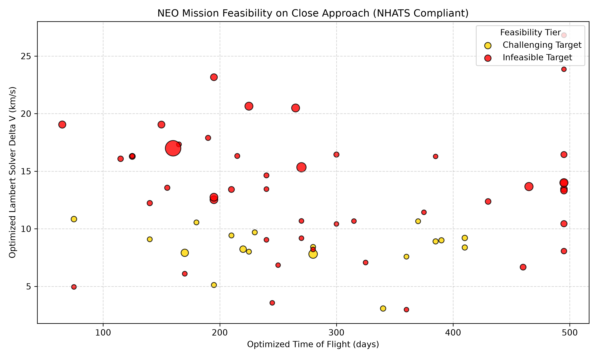
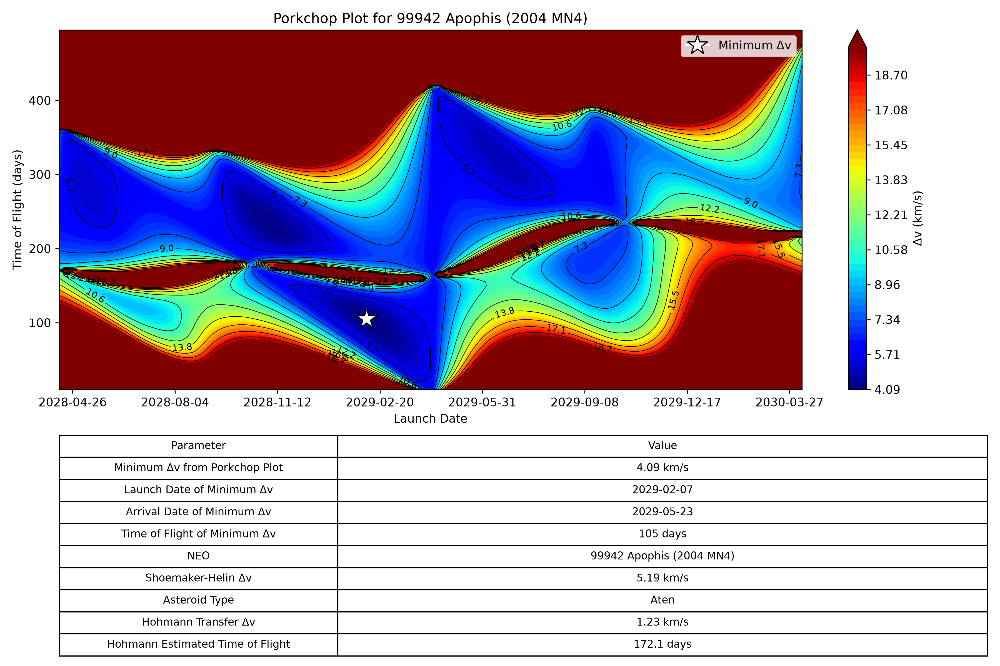

# Near Earth Object Feasibility and Porkchop Plot Calculator 

A tool for analyzing the feasibility of crewed missions to Near Earth Objects (NEOs) during their close approach date and how it may change for different dates. Given a date range, it pulls live NEO data from NASA’s NeoWs API, computes transfer trajectories using multiple independent orbital mechanics methods, generates a plot ranking the feasibility for each NEO listed for that date, and provides the user an option to view the porkchop plot for any specific NEO.

## Technical Overview 

The pipeline combines live NEO orbital data from NASA, Jet Propulsion Laboratory (JPL) Ephemeris data, and three different methods of Δv calculations to verify the feasibility of accessing each NEO and modeling how it changes over time.

### Lambert’s Problem Solver

Implemented from scratch – no orbital mechanics libraries used within the solver’s calculations – to sweep over multiple times of flights and dates to calculate a position specific Δv.

### Shoemaker-Helin Calculation

Includes code that classifies NEOs depending on their orbital paths relative to Earth’s orbit around the sun and uses these categories to calculate a realistic minimum Δv that accounts for inclination and eccentricity.

### Hohmann Transfer Calculation

Includes a baseline calculation of Δv assuming a perfectly circular, coplanar orbit.

### NHATS Feasibility Plot

The script uses the minimum Lambert’s Problem Δv and its corresponding time of flight along with the diameter of the NEO to categorize how feasible a mission is during its close approach date and create a plot to illustrate it.

### Porkchop Plot

The user is able to click on any NEO on the feasibility plot causing the script to generate a full porkchop plot that uses contour lines and colors to portray optimal launch windows across ±1 year around its close approach.

### Async Data Retrieval

NEO Orbital data is fetched concurrently via asyncio/aiohttp rather than sequentially in order to speed up the calculations as waiting for data from dozens of NEOs from NASA’s API before executing the looping Lambert Solver is highly time consuming.

### Ephemeris via JPL Horizons

Earth’s position and velocity vectors are pulled live from JPL’s Horizons system (via astroquery) instead of being approximated. The porkchop plot also takes selected NEO’s vectors from Horizons, so both ends of the transfer use real positions and the NEO’s orbit includes planetary gravity and close flybys. The feasibility chart instead propagates NASA’s orbital elements with two-body motion for speed. If a Horizons lookup fails, the program prints a message and falls back to the two-body method.

## Purpose

### Mission Feasibility Analysis

The calculator quickly screens which of the NEOs are likely accessible for a crewed mission. Once technology becomes available for crewed missions to be sent to NEOs on a regular basis, this tool can help determine which NEOs should be targeted for an inputted date range or indicate another date where a target may be more optimal. This code acts as a great mission planning tool to initially screen what targets are most accessible and offer more to explore in a single journey so that mission planners can spend more time looking at optimal targets rather than wasting time on NEOs that may never be feasible to access.

### The Relationship of NEO Accessibility and Close Approach Date

The porkchop plot shows how accessibility changes as the launch date moves away from the close approach date. Comparing the date of the lowest Δv with the close approach date shows how far from the flyby the best launch window falls for a given NEO.

### Providing Visual Representations

The feasibility chart shows Δv, time of flight, and diameter together (color for the feasibility tier, point size for diameter), which makes it easier to compare many NEOs at once rather than a table of numbers. The porkchop plot does the same for one NEO across launch dates and flight times. The tool is meant as a quick visual screen, not a replacement for detailed mission design.

## Usage

### Requirements

- Python 3.14
- All requirements are listed in `requirements.txt` in the GitHub Repository for this project, install these before running the program.
- A valid API key will also need to be acquired from api.nasa.gov.

### Running the Program

- To start the program, type `python3 Main_Orbital.py` in the terminal/command window.
- When prompted, enter start date in the format: YYYY-MM-DD.
- When prompted, enter an end date within a week of the start date in the format: YYYY-MM-DD.
- When prompted, enter a NASA API Key.
- The program will then load a plot with all the NEOs for the inputted date range. The user can hover their mouse over each NEO and the specific data will be presented.
- If the user would like more information about a particular NEO, they can click on it, and the program will load the porkchop plot for that NEO.
- To finish the program, use "ctrl + c" to quit.

## Example Outputs

The following outputs are for the date range from 04/12/2029 to 04/14/2029. The notable NEO in this date range is 99942 Apophis which has been widely studied as a large diameter, low Δv target due to its historic April 13, 2029 close approach – one of the closest Earth encounters ever predicted in advance for an asteroid of its size. The calculator returns a minimum one-way heliocentric rendezvous transfer Δv of 4.09 km/s with a departure date of 02/07/2029 and arrival date of 05/23/2029, a 105-day flight. The Shoemaker-Helin method gives 5.19 km/s including departure from low Earth orbit while the simplified Hohmann gives 1.23 km/s leaving out Apophis’ eccentricity and inclination. The feasibility chart used the two-body method to provide a quick estimate on the close approach date while the porkchop plot uses Horizons to gather more accurate calculations. This allows for the model to account for Apophis’ flyby which will significantly change its orbit due to Earth’s gravitational pull that the two-body problem would not include in the position calculation. For that reason, the feasibility chart’s Apophis point is unreliable and should not be compared with the porkchop plot minimum.

### Feasibility Chart

### Porkchop Plot

## Validation

The GitHub Repository includes multiple tests to validate the calculator. These tests can be found in the `Prograde_Lambert_Test.py`, `Retrograde_Lambert_Test.py`, and `Vector_Test.py` files.

### Textbook

Using the textbook that guided this project, Curtis, Orbital Mechanics for Engineering Students (1st ed., 2005), the Lambert solver was run on the Example 5.2 inputs. The solver’s v₁ and v₂ match the book’s values to its printed precision.

### Round-Trip Propagation

The solver’s departure velocity was flown with an independent numerical integrator (the Runge-Kutta method using SciPy) and the difference between the propagated position and the target position was measured. For the prograde Earth centered case, it was 1.1 × 10⁻⁷ km, for the retrograde case it was 8.7 × 10⁻⁸ km (with the angular momentum pointing the opposite way) and about 3 m for a prograde heliocentric transfer of 200 days between made-up positions at 1 AU and 1.52 AU, 100° apart.

### Orbital Elements to State Vectors

Offline tests on a made-up orbit agree with independent numerical propagation, satisfy the vis-viva equation, and give the correct orbit orientation.

### Comparison with JPL Horizons

For Apophis, the two-body state printed 0.0 km at 0.1 km precision when compared to Horizons on the epoch of NASA’s orbital elements. The position error grew to about 285 km after 30 days, 23,000 km after 180 days, and 46,000 km after a year, which is small compared with the orbit and supports using it for feasibility screening. After the April 2029 flyby, the error reaches about 10.5 million km. That is why the porkchop plot uses Horizons. This comparison was only done for Apophis.

## Limitations

- The feasibility chart uses two-body propagation, so NEOs with very close flybys can have unreliable points.
- The accuracy of porkchop plots depends on a successful Horizons lookup. If it fails, the program falls back to the two-body orbit with the same limitation.
- Δv is one-way, heliocentric, and for a rendezvous. It includes no Earth-departure burn and no return trip.
- The time-of-flight sweep covers 10 to 500 days, so results at the edge of that range may not be the true minimum.
- Launch dates are on a 5-day grid, so the porkchop minimum is resolved to about 5 days.
- The solver handles zero-revolution transfers only.
- The dark red bands in the porkchop plots are a known Lambert singularity near a 180° transfer angle, not a plotting error.
- The feasibility tiers are inspired by NHATS criteria, but they are applied to a one-way heliocentric Δv and time of flight, so they are rough screening cutoffs that I chose, not an actual NHATS compliance check.
- The solver was validated for prograde heliocentric transfers and one Earth-centered retrograde case. The comparison with Horizons was done for Apophis only so the error behavior for other NEOs has not been fully checked.

## Citations

Anthropic. (2026). *Claude* [Large language model]. https://claude.ai

Barbee, B. W., Abell, P. A., Adamo, D. R., Alberding, C. M., Mazanek, D. D., Johnson, L. N., Yeomans, D. K., Chodas, P. W., Chamberlin, A. B., & Friedensen, V. P. (2013, April 16). *The Near-Earth Object Human Space Flight Accessible Targets Study: An ongoing effort to identify near-Earth asteroid destinations for human explorers* (IAA-PDC13-04-13) [Conference presentation]. 2013 IAA Planetary Defense Conference. International Academy of Astronautics. https://iaaspace.org/wp-content/uploads/iaa/Scientific%20Activity/conf/pdc2013/IAA-PDC13-04-13pr.pdf

Boden, R. C., Hein, A. M., & Kawaguchi, J. (2015). Target selection and mass estimation for manned NEO exploration using a baseline mission design. *Acta Astronautica*, 111, 198–221. https://doi.org/10.1016/j.actaastro.2015.02.018

Curtis, H. D. (2005). *Orbital Mechanics for Engineering Students* (1st ed.). Elsevier / Butterworth-Heinemann. [Chapters 2, 3, 5, & 6: Two-Body Mechanics, Kepler's Equation, Universal Variables, Lambert's Problem, and Hohmann Transfers].

Elvis, M., McDowell, J., Hoffman, J. A., & Binzel, R. P. (2011). Ultra-low delta-v objects and the human exploration of asteroids. *Planetary and Space Science*, 59(13), 1408–1412. https://doi.org/10.1016/j.pss.2011.05.006

Ginsburg, A., Sipőcz, B. M., Brasseur, C. E., et al. (2019). astroquery: An Astronomical Web-Querying Package in Python. *The Astronomical Journal*, 157(3), 98.

Giorgini, J. D., Yeomans, D. K., Chamberlin, A. B., Chodas, P. W., Jacobson, R. A., Keesey, M. S., Lieske, J. H., Ostro, S. J., Standish, E. M., & Wimberly, R. N. (1996). JPL's On-Line Solar System Data Service. *Bulletin of the American Astronomical Society*, 28, 1158.

Harris, C. R., Millman, K. J., van der Walt, S. J., et al. (2020). Array programming with NumPy. *Nature*, 585, 357–362.

Hunter, J. D. (2007). Matplotlib: A 2D graphics environment. *Computing in Science & Engineering*, 9(3), 90–95.

NASA Center for Near-Earth Object Studies. (n.d.). *Near-Earth Object Human Space Flight Accessible Targets Study (NHATS) Guidelines & Caveats*. JPL / NASA. https://cneos.jpl.nasa.gov/nhats/caveats.html

NASA Center for Near-Earth Object Studies. (n.d.). *Near Earth Object Groups*. JPL / NASA. https://cneos.jpl.nasa.gov/about/neo_groups.html

NASA Center for Near-Earth Object Studies. (n.d.). *NeoWs (Near Earth Object Web Service) REST API*. https://api.nasa.gov/

Shoemaker, E. M., & Helin, E. F. (1978). Earth-approaching asteroids as targets for exploration. In *Asteroids: An Exploration Assessment* (NASA-CP-2053), pp. 245–256. NASA.

Spacecraft Robotics Lab. (2020, December 23). *Orbital Mechanics - Solving Kepler's Time Equation and Orbital Elements* [Video]. YouTube. https://www.youtube.com/watch?v=zi0FGTGnbB4

Virtanen, P., Gommers, R., Oliphant, T. E., et al. (2020). SciPy 1.0: Fundamental algorithms for scientific computing in Python. *Nature Methods*, 17, 261–272.

## AI Assistance Note

I used Claude (Anthropic) as a coding reviewer and to guide my understanding of much of this content, as I have not covered it yet in my studies. It mostly helped with writing the test functions, the Horizons helper (`Horizons_NEO.py`), debugging plotting errors, and reviewing this README. The orbital mechanics implementation in `Main_Orbital.py` and the analysis are my own, and I checked the results against Curtis's textbook and JPL Horizons.